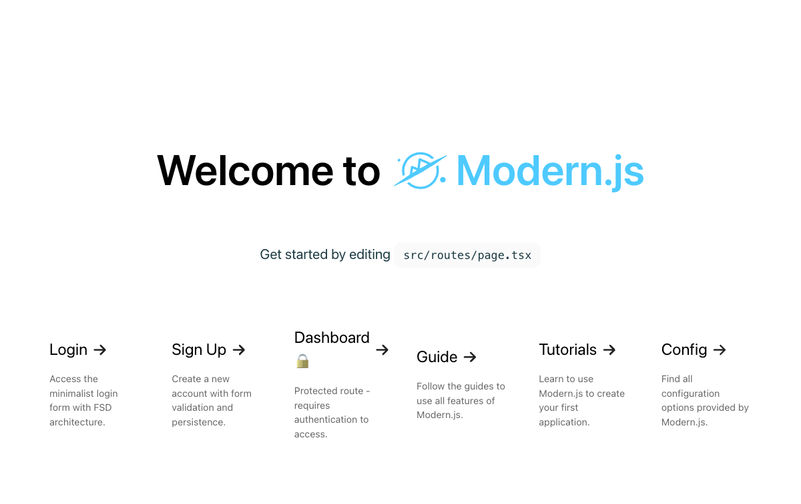

# Syncop Frontend

[](https://modernjs.dev/)
[](https://react.dev/)
[](https://www.typescriptlang.org/)



Syncop Frontend is a Modern.js and React application for personal finance workflows. The repository combines a feature-oriented frontend with Modern.js BFF routes that proxy requests to a separate backend API.

The checked-in root route currently remains the Modern.js starter page. The finance modules and protected routes are present in the source tree and are being developed behind it.

## Features

- Authentication with sign-in, sign-up, session state, and protected routes.
- Account, transaction, category, budget, goal, and recurring-transaction modules.
- Financial dashboard, reports, CSV import, and data-management components.
- React Query for server state and Zustand for client-side authentication state.
- Modern.js BFF endpoints under `api/lambda/`.

## Tech Stack

- Modern.js 2.68.19 with Rspack and the BFF plugin.
- React 18.3.1 and TypeScript 5.7.3.
- Ant Design 5.28.0 and Tailwind CSS 3.4.14.
- TanStack React Query 5.90.7 and Zustand 5.0.8.
- React Hook Form, Axios, and dayjs.
- Biome, lint-staged, and simple-git-hooks for code quality.

## Prerequisites

- Node.js `>=16.18.1`.
- pnpm.
- The companion backend API running at `http://localhost:8081`.

See [`backend.md`](backend.md) for backend setup details.

## Getting Started

```sh
pnpm install
pnpm dev
```

Open the local URL printed by Modern.js, typically `http://localhost:8080`.

## Commands

| Command | Purpose |
| --- | --- |
| `pnpm dev` | Start the Modern.js development server |
| `pnpm build` | Create a production build |
| `pnpm start` | Start the production server |
| `pnpm serve` | Preview the production build |
| `pnpm lint` | Run Biome checks |
| `pnpm reset` | Remove dependency directories |
| `pnpm new` | Run the Modern.js generator |
| `pnpm upgrade` | Upgrade Modern.js dependencies |

## Routes

| Route | Access | Purpose |
| --- | --- | --- |
| `/` | Public | Current Modern.js starter landing page |
| `/login` | Public | Sign-in form |
| `/signup` | Public | Account registration |
| `/dashboard` | Protected | Financial dashboard and reports |
| `/profile` | Protected | User profile |
| `/settings` | Protected | User settings |

## Project Structure

```text
api/lambda/       BFF endpoints for auth and finance resources
src/app/           Application providers
src/features/      Feature modules and API clients
src/routes/        Page routes
src/shared/        Shared API and UI utilities
modern.config.ts   Modern.js, Tailwind, and BFF configuration
```

Feature modules generally expose API functions, types, forms or components, and an `index.ts` entry point. BFF route implementations live under `api/lambda/` and use the backend URL defined in the route files.

## Development Notes

The default BFF routes target `http://localhost:8081/api`. Authentication tokens are stored in the browser and forwarded by the API client. Do not commit credentials or production secrets.

No license is currently declared in the repository.
